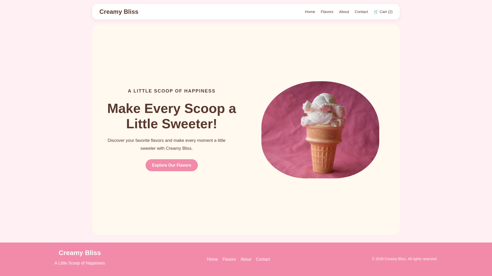
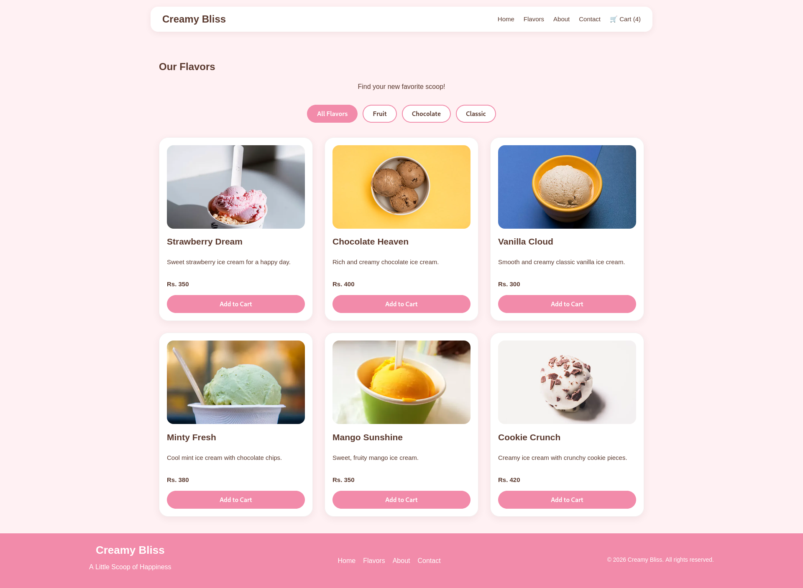
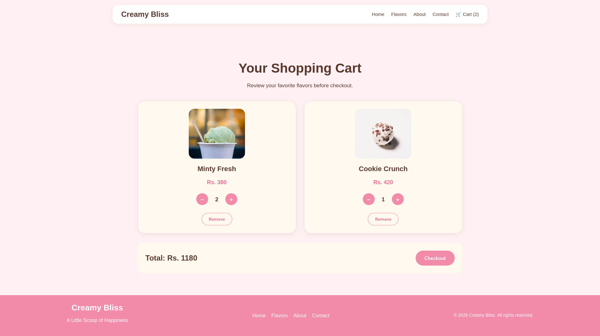

# Creamy Bliss 🍦


A responsive ice cream shopping website built with Next.js and React.

**Live Website:** https://creamy-bliss-plum.vercel.app

**GitHub Repository:** https://github.com/zinegn-dev/creamy-bliss

## About the Project
Creamy Bliss is a responsive ice cream shopping website designed to provide a smooth and enjoyable shopping experience.

Visitors can explore a variety of ice cream flavors, browse products by category, and manage their shopping cart with quantity controls and automatic price calculations.

The website features a playful pastel design, responsive layouts, and a simple navigation experience across desktop, tablet, and mobile devices.

## Screenshots

### Homepage


### All Flavors


### Shopping Cart

## Features

- Responsive design for desktop, tablet, and mobile.
- Product listing with six ice cream flavors.
- Product filtering by category.
- Add products to the shopping cart.
- Increase and decrease product quantities.
- Automatic cart total calculation.
- Cart data saved using localStorage.
- Separate Home, Flavors, About, Contact, and Cart pages.
- Demo checkout (no real payment processing).

## Technologies Used

- Next.js
- React
- JavaScript
- CSS
- HTML
- localStorage
- Git and GitHub
- Vercel

## Getting Started

To run this project on your computer:

1. Clone the repository:

   ```bash
   git clone https://github.com/zinegn-dev/creamy-bliss.git
   ```

2. Open the project folder:

   ```bash
   cd creamy-bliss
   ```

3. Install dependencies:

   ```bash
   npm install
   ```

4. Start the development server:

   ```bash
   npm run dev
   ```

5. Open http://localhost:3000 in your browser.

## Deployment

This project is deployed using Vercel.

Live Website: https://creamy-bliss-plum.vercel.app

## Note

The checkout is for demonstration purposes only. It does not process real payments or create real orders.

